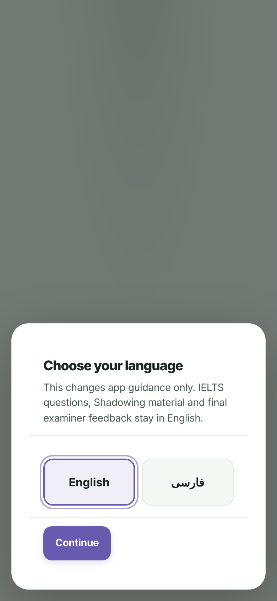
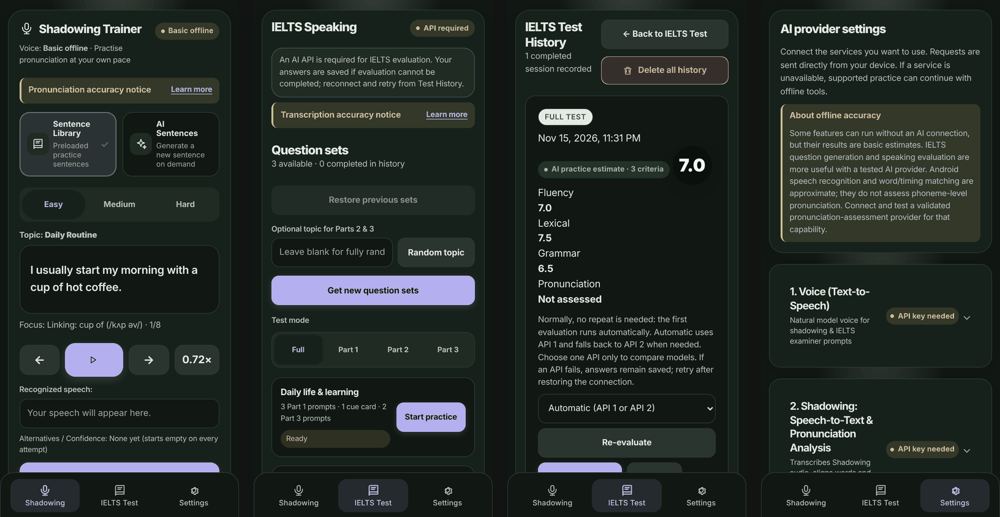

<div align="center" dir="rtl">


# SpeakCoach

**تمرین شدوئینگ انگلیسی و اسپیکینگ آیلتس برای اندروید — با هوش مصنوعی خودتان، بدون سرور، و کلیدهایتان فقط روی گوشی شما.**

[English](README.md) · [فارسی](README.fa.md)

[](https://github.com/AriyanD/SpeakCoach/releases/latest)
[](https://github.com/AriyanD/SpeakCoach/actions/workflows/build-apk.yml)


</div>

<div align="center">

[](https://www.coffeebede.com/ariyand)

</div>

<div dir="rtl">

> اسکرین‌شات‌ها از رابط واقعی برنامه و با **داده‌های نمونهٔ کاملاً ساختگی** (چند مجموعه سؤال و یک نتیجهٔ نمونه) گرفته شده‌اند. هیچ سرویس یا حساب واقعی در آن‌ها نیست. رابط برنامه در حال حاضر انگلیسی است و راهنمای راه‌اندازی داخل برنامه به فارسی هم موجود است.

## SpeakCoach چیست؟

SpeakCoach یک مربی تمرین برای کسانی است که می‌خواهند طبیعی‌تر انگلیسی صحبت کنند و برای بخش Speaking آزمون آیلتس آماده شوند. دو ابزار اصلی دارد:

- **Shadowing Trainer (شدوئینگ)** – جمله را گوش می‌دهید، تکرار می‌کنید و دربارهٔ کلمات گفته‌شده و نزدیکی زمان‌بندی‌تان به جملهٔ الگو بازخورد کلمه‌به‌کلمه می‌گیرید.
- **IELTS Speaking (اسپیکینگ آیلتس)** – آزمون کامل، Part 1، Part 2 (با شمارش معکوس آمادگی و یادداشت) یا Part 3 را با مجموعه سؤال‌های تولیدشده با هوش مصنوعی تمرین می‌کنید و ارزیابی «تخمین تمرینی» می‌گیرید.

**سرور اختصاصی و اشتراکی در کار نیست.** ارائه‌دهنده‌های هوش مصنوعی خودتان (مثلاً Google Gemini یا Groq/Whisper) را وصل می‌کنید و برنامه مستقیماً از روی دستگاه شما با آن‌ها ارتباط می‌گیرد.

## ویژگی‌ها

### شدوئینگ
- کتابخانهٔ جملات داخلی بر اساس **موضوع** و **سطح** (Easy / Medium / Hard).
- **تولید جمله با هوش مصنوعی** در صورت نیاز، با موضوع دلخواه.
- پخش با **کنترل سرعت**، هم‌ترازی و زمان‌بندی کلمه‌به‌کلمه و پخش مجدد صدای خودتان (در صورت پشتیبانی).
- امتیازهای تقریبی تلفظ، روانی، سرعت و کامل‌بودن، و برجسته‌شدن کلمات ضعیف برای تکرار سریع.

### اسپیکینگ آیلتس
- حالت‌ها: **آزمون کامل، Part 1، Part 2، Part 3**.
- **مجموعه سؤال تولیدشده با هوش مصنوعی** (موضوع دلخواه یا تصادفی)، قابل ذخیره و بازیابی، با امکان بازگشت به تولید قبلی.
- **شمارش معکوس آمادگی و یادداشت** برای Part 2.
- **تاریخچه و روند پیشرفت**، بازخورد هر معیار، اصلاح جمله‌ها، پیشنهاد واژگان بهتر و **ارزیابی مجدد** با ارائه‌دهندهٔ انتخابی.
- اگر جلسه ناقص بماند، پاسخ‌هایتان ذخیره می‌شود و بعداً می‌توانید ارزیابی را دوباره امتحان کنید.

### هوش مصنوعی انعطاف‌پذیر، با جایگزین
پنج اسلات مستقل برای ارائه‌دهنده، هرکدام با **API 1 ← API 2 (جایگزین)** و در صورت امکان یک سطح آفلاین:

| اسلات | کار | جایگزین پایه |
|---|---|---|
| Voice / TTS | خواندن جمله‌ها و سؤال‌های آزمونگر | Android Text-to-Speech |
| Pronunciation / Shadowing | تبدیل گفتار شدوئینگ به متن و هم‌ترازی | تشخیص گفتار اندروید + هم‌ترازی تقریبی |
| IELTS Speech-to-Text | تبدیل پاسخ‌های آیلتس به متن | تشخیص گفتار اندروید |
| IELTS Evaluator | بازخورد Fluency، Lexical Resource و Grammar | ندارد – پاسخ‌ها برای تلاش مجدد ذخیره می‌شوند |
| Question & Sentence Generator | ساخت مجموعه سؤال آیلتس و جملات شدوئینگ | مجموعه‌های قبلاً ساخته‌شده در دسترس می‌مانند |

انواع ارائه‌دهنده: سرویس‌های سازگار با OpenAI، درگاه‌های سفارشی سازگار با OpenAI، Azure، ElevenLabs، Google Gemini، رونویسی به سبک Whisper (مثل Groq) و سرویس‌های گفتاری داخلی اندروید.

### ساخته‌شده برای استفادهٔ واقعی روی گوشی
- **راه‌اندازی اولیهٔ هدایت‌شده** به **انگلیسی یا فارسی** با راهنمای ۷ صفحه‌ای (دریافت API key، کار هر اسلات، و متن آمادهٔ پرسش از چت‌بات).
- تم **روشن / تاریک / سیستم**.
- **پشتیبان‌گیری و بازیابی دستی** از تنظیمات هوش مصنوعی (همراه کلیدها؛ مثل فایل رمز عبور نگه دارید) یا داده‌های آزمون (بدون کلید).
- **به‌روزرسانی داخل برنامه** از GitHub Releases با راستی‌آزمایی SHA-256 پیش از نصب.
- صفحهٔ عیب‌یابی با حذف اطلاعات حساس، بدون افشای کلیدها.

### حریم خصوصی و امنیت
- بدون سرور تحلیلی یا سرور SpeakCoach؛ درخواست‌ها مستقیم به ارائه‌دهنده‌هایی که خودتان تنظیم می‌کنید می‌رود.
- کلیدهای API با **Android Keystore (AES-GCM)** نگهداری می‌شوند و بی‌صدا به متن ساده تنزل نمی‌یابند.
- پشتیبان‌گیری خودکار اندروید غیرفعال است؛ از پشتیبان‌گیری دستی برنامه استفاده کنید.
- با رفتن برنامه به پس‌زمینه، میکروفون و TTS آزاد می‌شوند.

## محدودیت‌ها (صادقانه)

SpeakCoach ابزار تمرین است، نه آزمون رسمی:

- **نمرات هوش مصنوعی «تخمین تمرینی» هستند، نه نمرهٔ رسمی آیلتس.**
- **برای تلفظ (Pronunciation) نمرهٔ آیلتس داده نمی‌شود.** اطمینان تشخیص گفتار معیار معتبری برای تلفظ نیست؛ برنامه آن را «Not assessed» می‌گذارد.
- **امتیازهای شدوئینگ تقریبی هستند** (تطبیق کلمه، هم‌ترازی، زمان‌بندی) و ارزیابی در سطح واج انجام نمی‌شود.
- **بانک سؤال آیلتس داخل برنامه نیست.** ساخت مجموعه سؤال به هوش مصنوعی آنلاین نیاز دارد؛ مجموعه‌هایی که قبلاً ساخته‌اید آفلاین هم در دسترس‌اند.
- **تشخیص گفتار آفلاین به گوشی شما بستگی دارد.** ممکن است تشخیص‌دهندهٔ اندروید باز هم به اینترنت نیاز داشته باشد.
- قابلیت‌های آنلاین از **حساب و سهمیهٔ خودتان** مصرف می‌کنند. موفق‌بودن تست اتصال دقت ارائه‌دهنده را تأیید نمی‌کند.

## نصب

1. صفحهٔ [**Releases**](https://github.com/AriyanD/SpeakCoach/releases/latest) را باز کنید و فایل `SpeakCoach-vX.Y.Z.apk` را دانلود کنید.
2. هنگام درخواست اندروید، نصب از مرورگر/مدیر فایل را مجاز کنید و فایل APK را باز کنید.
3. SpeakCoach را اجرا کنید، زبان را انتخاب کنید و راهنمای راه‌اندازی را دنبال کنید.

برای فهرست تست دستی روی دستگاه، [docs/DEVICE_TEST_CHECKLIST.md](docs/DEVICE_TEST_CHECKLIST.md) را ببینید.

## شروع سریع

1. **API key بگیرید.** گزینه‌های مناسب برای شروع: [Google AI Studio](https://aistudio.google.com/app/apikey) (Gemini) و [Groq](https://console.groq.com/keys) (رونویسی Whisper).
2. در **Settings** یک اسلات را باز کنید، ارائه‌دهنده را انتخاب کنید، کلید را وارد کنید، **Test** و سپس **Save** بزنید. همین کار را برای اسلات‌های دلخواه تکرار کنید.
3. **شدوئینگ:** موضوع و سطح را انتخاب کنید، گوش دهید و سپس صدای خودتان را ضبط کنید.
4. **آیلتس:** روی *Get new question sets* بزنید، حالت آزمون را انتخاب و تمرین را شروع کنید. بازخورد را در *Test History* ببینید.

## ساخت از سورس

نیازمندی‌ها: Node.js 20+ و npm (برای ساخت APK: JDK 21 و Android SDK).

</div>

```bash
npm ci
npm test            # تست‌های Vitest
npm run dev         # سرور توسعه در مرورگر (MOBILE_PREVIEW.md)
npm run build       # بررسی نوع + ساخت وب

npm run cap:sync    # ساخت و همگام‌سازی با اندروید
cd android && ./gradlew assembleDebug
```

<div dir="rtl">

با push کردن یک تگ `v*`، گردش‌کار GitHub Actions اجرا می‌شود و یک نسخهٔ امضاشدهٔ `SpeakCoach-vX.Y.Z.apk` منتشر می‌کند. جزئیات امضا، هماهنگی نسخه‌ها، قوانین به‌روزرسانی داخلی، پشتیبان‌گیری و وابستگی‌ها در [docs/TECHNICAL_NOTES.md](docs/TECHNICAL_NOTES.md) (انگلیسی) آمده است.

## فناوری‌ها

TypeScript · رابط کاربری DOM خالص · Vite · Capacitor 6 (اندروید) · Vitest · GitHub Actions. تصمیم‌های طراحی در [DECISIONS.md](DECISIONS.md) ثبت شده‌اند.

## مستندات

- [یادداشت‌های فنی: انتشار، امضا، به‌روزرسانی، پشتیبان‌گیری](docs/TECHNICAL_NOTES.md)
- [فهرست تست روی دستگاه](docs/DEVICE_TEST_CHECKLIST.md)
- [تصمیم‌های معماری](DECISIONS.md)
- [پیش‌نمایش موبایل در مرورگر](MOBILE_PREVIEW.md)

## اسکرین‌شات‌ها

</div>

<div align="center">

| زبان | راهنمای راه‌اندازی | شدوئینگ |
|:--:|:--:|:--:|
|  |  |  |

| آیلتس | تاریخچه (نمونه) | تنظیمات |
|:--:|:--:|:--:|
|  |  |  |

<details>
<summary>تم تاریک</summary>



</details>

</div>

<div dir="rtl">

## حمایت از پروژه ☕

SpeakCoach **رایگان** است و بدون سرور و اشتراک ارائه می‌شود. اگر برایتان مفید بود و دوست داشتید از ادامهٔ توسعه‌اش حمایت کنید، می‌توانید یک قهوه مهمان من باشید:

<div align="center">

### ☕ [از من در کافی‌بده حمایت کنید](https://www.coffeebede.com/ariyand)

</div>

حمایت مالی کاملاً اختیاری است؛ ستاره‌دادن به مخزن، گزارش باگ و معرفی برنامه به دوستانتان هم خیلی کمک می‌کند. 💜

## مجوز

هنوز فایل مجوزی به این مخزن اضافه نشده است؛ تا زمان افزودن، همهٔ حقوق نزد نویسنده محفوظ است.

</div>
