<div align="center" dir="rtl">


# SpeakCoach

**تمرین شدوئینگ چندزبانه و اسپیکینگ آیلتس انگلیسی برای اندروید — با هوش مصنوعی خودتان، بدون سرور، و کلیدهایتان فقط روی گوشی شما.**

[English](README.md) · [فارسی](README.fa.md)

[](https://github.com/AriyanD/SpeakCoach/releases/latest)
[](https://github.com/AriyanD/SpeakCoach/actions/workflows/build-apk.yml)


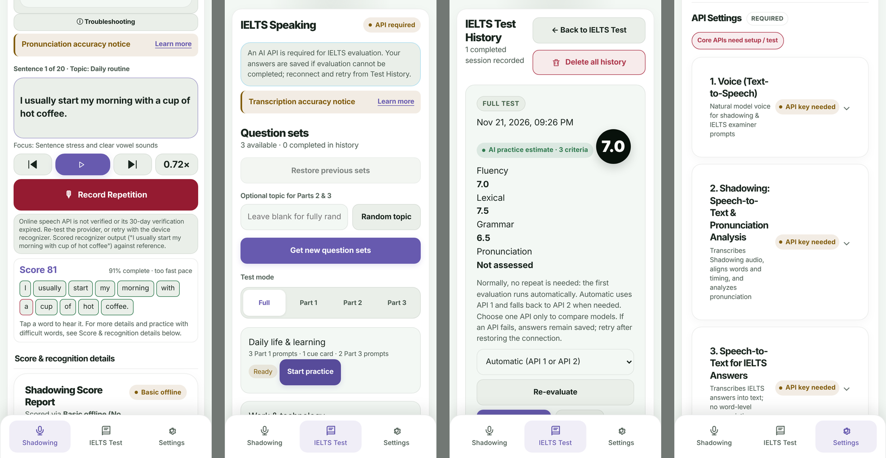

</div>

<div align="center">

<a href="https://www.coffeebede.com/ariyand"></a>

<sub>SpeakCoach رایگان است و سرور و اشتراک ندارد. اگر به تمرینتان کمک کرد، یک قهوه به ادامهٔ توسعه کمک می‌کند. 💜</sub>

</div>

<div dir="rtl">

> اسکرین‌شات‌ها از رابط واقعی برنامه و با **داده‌های نمونهٔ کاملاً ساختگی** (چند مجموعه سؤال و یک نتیجهٔ نمونهٔ آیلتس) گرفته شده‌اند. امتیاز شدوئینگ با خروجی شبیه‌سازی‌شدهٔ تشخیص گفتار و بدون اتصال به هیچ ارائه‌دهنده‌ای ساخته شده است. هیچ سرویس یا حساب واقعی در آن‌ها نیست. رابط برنامه از انگلیسی و فارسی پشتیبانی می‌کند.

## SpeakCoach چیست؟

SpeakCoach یک مربی تمرین برای کسانی است که می‌خواهند در زبان‌های مختلف طبیعی‌تر صحبت کنند و برای بخش Speaking آزمون آیلتس به انگلیسی آماده شوند. دو ابزار اصلی دارد:

- **Shadowing Trainer (شدوئینگ)** – زبان و جمله را انتخاب می‌کنید، گوش می‌دهید، تکرار می‌کنید و دربارهٔ کلمات گفته‌شده و نزدیکی زمان‌بندی‌تان به جملهٔ الگو بازخورد کلمه‌به‌کلمه می‌گیرید.
- **IELTS Speaking (اسپیکینگ آیلتس)** – آزمون کامل، Part 1، Part 2 (با شمارش معکوس آمادگی و یادداشت) یا Part 3 را با مجموعه سؤال‌های تولیدشده با هوش مصنوعی تمرین می‌کنید و ارزیابی «تخمین تمرینی» می‌گیرید.

**سرور اختصاصی و اشتراکی در کار نیست.** ارائه‌دهنده‌های هوش مصنوعی خودتان (مثلاً Google Gemini یا Groq/Whisper) را وصل می‌کنید و برنامه مستقیماً از روی دستگاه شما با آن‌ها ارتباط می‌گیرد.

## ویژگی‌ها

### شدوئینگ
- کتابخانهٔ جملات داخلی بر اساس **موضوع** و **سطح** (Easy / Medium / Hard).
- **تولید مجموعهٔ جمله (۲۰ جمله‌ای) با هوش مصنوعی** در صورت نیاز، با موضوع دلخواه، و **تاریخچه‌ای** که می‌توانید در آن به مجموعه‌های قبلی برگردید.
- پخش با **کنترل سرعت** (عادی و ۰٫۷۲×)، هم‌ترازی و زمان‌بندی کلمه‌به‌کلمه و پخش مجدد صدای خودتان (در صورت پشتیبانی).
- **نوار امتیاز فشرده** درست زیر دکمهٔ ضبط: امتیاز کلی، چیپ‌های رنگی کلمات (با زدن روی هر کلمه تلفظش را بشنوید) و جزئیات در ادامه.
- امتیازهای تقریبی تلفظ، روانی، سرعت و کامل‌بودن، و برجسته‌شدن کلمات ضعیف برای تکرار سریع.
- **پخش مجدد سریع:** صدای هوش مصنوعی مجموعهٔ فعال روی گوشی ذخیره می‌شود؛ جمله‌هایی که قبلاً شنیده‌اید حتی بعد از بستن و باز کردن برنامه فوراً پخش می‌شوند. جمله‌های بعدی با پیشرفت شما به‌صورت گروه‌های چهارتایی در پس‌زمینه گرفته می‌شوند (برای صرفه‌جویی در سهمیه می‌توانید در تنظیمات خاموشش کنید).

### اسپیکینگ آیلتس
- حالت‌ها: **آزمون کامل، Part 1، Part 2، Part 3**.
- **مجموعه سؤال تولیدشده با هوش مصنوعی** (موضوع دلخواه یا تصادفی)، قابل ذخیره و بازیابی، با امکان بازگشت به تولید قبلی.
- **شمارش معکوس آمادگی و یادداشت** برای Part 2.
- **تاریخچه و روند پیشرفت**، بازخورد هر معیار، اصلاح جمله‌ها، پیشنهاد واژگان بهتر و **ارزیابی مجدد** به‌صورت خودکار، فقط با API 1 یا فقط با API 2. اگر ارزیابی مجدد شکست بخورد، دلیلش همان‌جا نشان داده می‌شود و نمره‌ای که از قبل دارید هرگز پاک نمی‌شود.
- اگر جلسه ناقص بماند، پاسخ‌هایتان ذخیره می‌شود و بعداً می‌توانید ارزیابی را دوباره امتحان کنید.

### هوش مصنوعی انعطاف‌پذیر، با جایگزین
شش اسلات مستقل برای ارائه‌دهنده، هرکدام با تنظیمات جداگانه و **API 1 ← API 2 (جایگزین)**؛ در صورت پشتیبانی، سطح آفلاین هم دارند:

| اسلات | کار | جایگزین پایه |
|---|---|---|
| Voice / TTS | خواندن جمله‌ها و سؤال‌های آزمونگر | Android Text-to-Speech |
| Pronunciation / Shadowing | تبدیل گفتار شدوئینگ به متن و هم‌ترازی | تشخیص گفتار اندروید + هم‌ترازی تقریبی |
| IELTS Speech-to-Text | تبدیل پاسخ‌های آیلتس به متن | تشخیص گفتار اندروید |
| IELTS Evaluator | بازخورد Fluency، Lexical Resource و Grammar | ندارد – پاسخ‌ها برای تلاش مجدد ذخیره می‌شوند |
| Question & Sentence Generator | ساخت مجموعه سؤال آیلتس و جملات شدوئینگ | مجموعه‌های قبلاً ساخته‌شده در دسترس می‌مانند |
| Shadowing Translator | ترجمهٔ جملهٔ فعلی شدوئینگ و واژه‌های انتخاب‌شده | ترجمهٔ آفلاین ندارد؛ باید ارائه‌دهندهٔ آنلاین تنظیم شود |

API 2 برای هر اسلات یک **حساب پشتیبان اختیاری** است. نتیجهٔ تست اتصال به همان ارائه‌دهنده، آدرس، مدل/صدا و کلید وابسته است و ۳۰ روز معتبر می‌ماند؛ وقتی یک API نیاز به تست دوباره دارد، بعد از محدودیت سهمیه در حالت استراحت است یا برنامه به سطح آفلاین برمی‌گردد، SpeakCoach دلیلش را می‌گوید و بی‌صدا خراب نمی‌شود. گزینهٔ **Settings ← Backup & Restore ← Test all APIs** همهٔ حساب‌های تنظیم‌شده را یک‌جا دوباره تست می‌کند و هر اسلات را فقط وقتی ذخیره می‌کند که همهٔ حساب‌های آنلاین تنظیم‌شده‌اش موفق باشند.

انواع ارائه‌دهنده: سرویس‌های سازگار با OpenAI، درگاه‌های سفارشی سازگار با OpenAI، Azure، ElevenLabs، Google Gemini، رونویسی به سبک Whisper (مثل Groq) و سرویس‌های گفتاری داخلی اندروید.

### ساخته‌شده برای استفادهٔ واقعی روی گوشی
- **راه‌اندازی اولیهٔ هدایت‌شده** به **انگلیسی یا فارسی** با راهنمای ۷ صفحه‌ای (دریافت API key، کار هر اسلات، و متن آمادهٔ پرسش از چت‌بات).
- تم **روشن / تاریک / سیستم**.
- **پشتیبان‌گیری و بازیابی دستی** از تنظیمات هوش مصنوعی (همراه کلیدها؛ مثل فایل رمز عبور نگه دارید) یا داده‌های آزمون (بدون کلید).
- **به‌روزرسانی داخل برنامه** از GitHub Releases با راستی‌آزمایی SHA-256 پیش از نصب.
- صفحهٔ عیب‌یابی با حذف اطلاعات حساس، بدون افشای کلیدها.

### حریم خصوصی و امنیت
- بدون سرور تحلیلی یا سرور SpeakCoach؛ درخواست‌ها مستقیم به ارائه‌دهنده‌هایی که خودتان تنظیم می‌کنید می‌رود.
- کلیدهای API با **Android Keystore (AES-GCM)** نگهداری می‌شوند و بی‌صدا به متن ساده تنزل نمی‌یابند.
- پشتیبان‌گیری خودکار اندروید غیرفعال است؛ از پشتیبان‌گیری دستی برنامه استفاده کنید.
- با رفتن برنامه به پس‌زمینه، میکروفون و TTS آزاد می‌شوند.
- صدای ذخیره‌شدهٔ هوش مصنوعی فقط حافظهٔ نهان محلیِ مجموعهٔ فعال است (حدود ۳۰ مگابایت بودجه)؛ با تغییر مجموعه جایگزین می‌شود، در پشتیبان‌گیری گنجانده نمی‌شود و ضبط‌های میکروفون شما هرگز در آن ذخیره نمی‌شود.

## محدودیت‌ها (صادقانه)

SpeakCoach ابزار تمرین است، نه آزمون رسمی:

- **نمرات هوش مصنوعی «تخمین تمرینی» هستند، نه نمرهٔ رسمی آیلتس.**
- **برای تلفظ (Pronunciation) نمرهٔ آیلتس داده نمی‌شود.** اطمینان تشخیص گفتار معیار معتبری برای تلفظ نیست؛ برنامه آن را «Not assessed» می‌گذارد.
- **امتیازهای شدوئینگ تقریبی هستند** (تطبیق کلمه، هم‌ترازی، زمان‌بندی) و ارزیابی در سطح واج انجام نمی‌شود.
- **بانک سؤال آیلتس داخل برنامه نیست.** ساخت مجموعه سؤال به هوش مصنوعی آنلاین نیاز دارد؛ مجموعه‌هایی که قبلاً ساخته‌اید آفلاین هم در دسترس‌اند.
- **تشخیص گفتار آفلاین به گوشی شما بستگی دارد.** ممکن است تشخیص‌دهندهٔ اندروید باز هم به اینترنت نیاز داشته باشد.
- قابلیت‌های آنلاین از **حساب و سهمیهٔ خودتان** مصرف می‌کنند. موفق‌بودن تست اتصال دقت ارائه‌دهنده را تأیید نمی‌کند.

## نصب

1. صفحهٔ [**Releases**](https://github.com/AriyanD/SpeakCoach/releases/latest) را باز کنید و فایل `SpeakCoach-vX.Y.Z.apk` را دانلود کنید.
2. هنگام درخواست اندروید، نصب از مرورگر/مدیر فایل را مجاز کنید و فایل APK را باز کنید.
3. SpeakCoach را اجرا کنید، زبان را انتخاب کنید و راهنمای راه‌اندازی را دنبال کنید.

حداقل نسخهٔ موردنیاز اندروید ۶٫۰ (API 23) است؛ اندروید ۵٫۱ (API 22) و نسخه‌های قدیمی‌تر پشتیبانی نمی‌شوند. برای فهرست تست دستی روی دستگاه، [docs/DEVICE_TEST_CHECKLIST.md](docs/DEVICE_TEST_CHECKLIST.md) را ببینید.

## شروع سریع

1. **API key بگیرید.** گزینه‌های مناسب برای شروع: [Google AI Studio](https://aistudio.google.com/app/apikey) (Gemini) و [Groq](https://console.groq.com/keys) (رونویسی Whisper).
2. در **Settings** هر شش اسلات را **مستقل از هم** تنظیم کنید: ارائه‌دهنده را انتخاب کنید، API key را وارد کنید (و در صورت نیاز Base URL و مدل را هم مشخص کنید)، روی **Test** و سپس **Save** بزنید. شش اسلات عبارت‌اند از Voice/TTS، تحلیل Shadowing، تبدیل گفتار IELTS به متن، ارزیاب IELTS، تولیدکنندهٔ سؤال و جمله، و **مترجم Shadowing**. مترجم تنظیمات API مستقل دارد؛ اگر ترجمهٔ جمله‌ها و واژه‌ها را می‌خواهید، آن را هم جداگانه تنظیم کنید. در صورت نیاز می‌توانید داخل هر اسلات API 2 را به‌عنوان جایگزین فعال کنید. بعد از بازیابی پشتیبان یا وقتی تستی بیش از ۳۰ روز پیش انجام شده، از **Settings ← Backup & Restore ← Test all APIs** برای بررسی یک‌جای همه چیز استفاده کنید.
3. **شدوئینگ:** موضوع و سطح را انتخاب کنید، گوش دهید و سپس صدای خودتان را ضبط کنید.
4. **آیلتس:** روی *Get new question sets* بزنید، حالت آزمون را انتخاب و تمرین را شروع کنید. بازخورد را در *Test History* ببینید.

## ساخت از سورس

نیازمندی‌ها: Node.js 20+ و npm (برای ساخت APK: JDK 21 و Android SDK).

</div>

```bash
npm ci
npm test            # تست‌های Vitest
npm run dev         # سرور توسعه در مرورگر (MOBILE_PREVIEW.md)
npm run build       # بررسی نوع + ساخت وب

npm run cap:sync    # ساخت و همگام‌سازی با اندروید
cd android && ./gradlew assembleDebug
```

<div dir="rtl">

با push کردن یک تگ `v*`، گردش‌کار GitHub Actions اجرا می‌شود و یک نسخهٔ امضاشدهٔ `SpeakCoach-vX.Y.Z.apk` منتشر می‌کند. جزئیات امضا، هماهنگی نسخه‌ها، قوانین به‌روزرسانی داخلی، پشتیبان‌گیری و وابستگی‌ها در [docs/TECHNICAL_NOTES.md](docs/TECHNICAL_NOTES.md) (انگلیسی) آمده است.

## فناوری‌ها

TypeScript · رابط کاربری DOM خالص · Vite · Capacitor 6 (اندروید) · Vitest · GitHub Actions. تصمیم‌های طراحی در [DECISIONS.md](DECISIONS.md) ثبت شده‌اند.

## مستندات

- [یادداشت‌های فنی: انتشار، امضا، به‌روزرسانی، پشتیبان‌گیری](docs/TECHNICAL_NOTES.md)
- [فهرست تست روی دستگاه](docs/DEVICE_TEST_CHECKLIST.md)
- [تصمیم‌های معماری](DECISIONS.md)
- [تغییرات و یادداشت‌های انتشار بعدی](CHANGELOG.md)
- [پیش‌نمایش موبایل در مرورگر](MOBILE_PREVIEW.md)

## اسکرین‌شات‌ها

</div>

<div align="center">

| زبان | راهنمای راه‌اندازی | شدوئینگ |
|:--:|:--:|:--:|
|  | 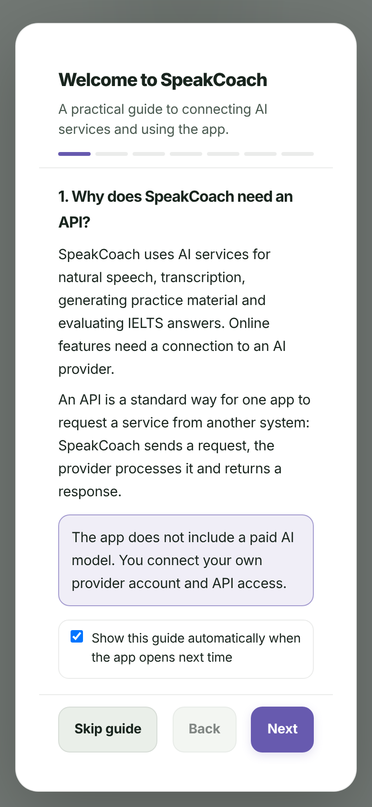 | 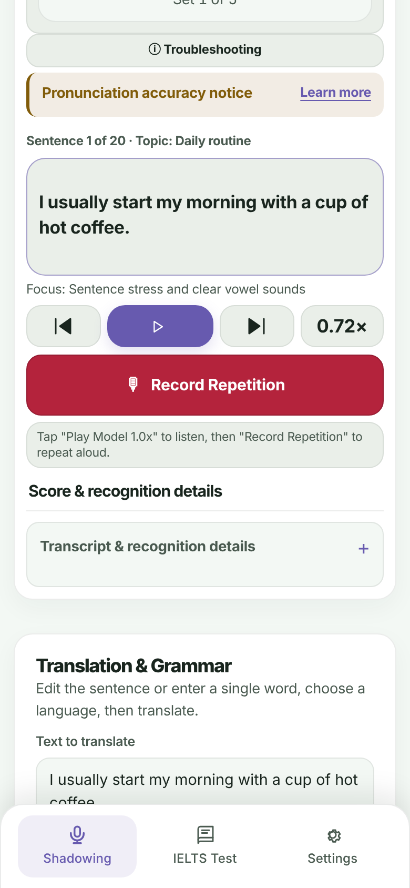 |

| امتیاز شدوئینگ | آیلتس | تاریخچه (نمونه) |
|:--:|:--:|:--:|
| 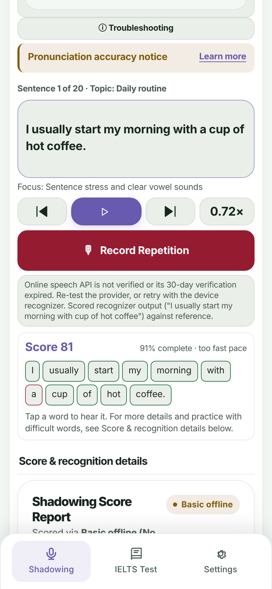 | 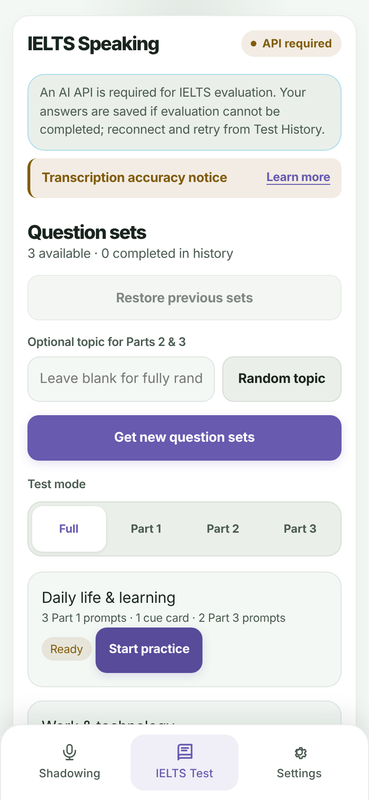 | 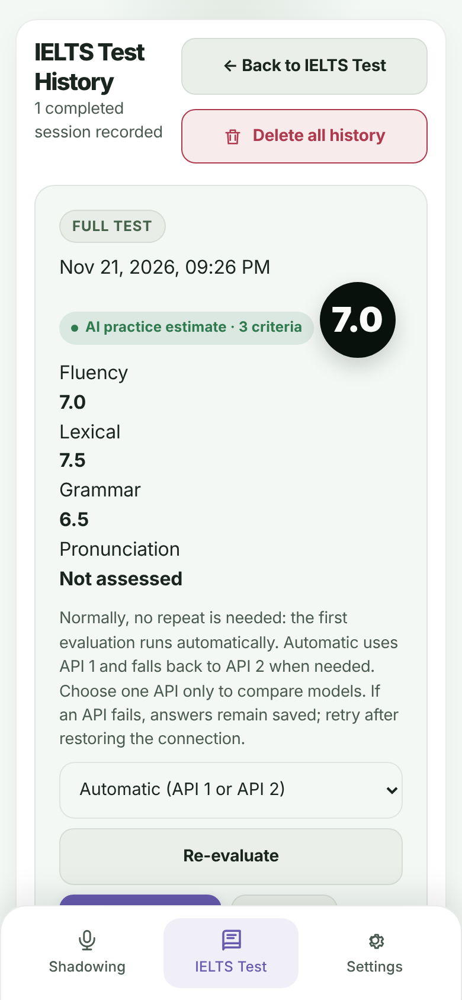 |

| تنظیمات | پشتیبان‌گیری و Test all APIs |
|:--:|:--:|
| 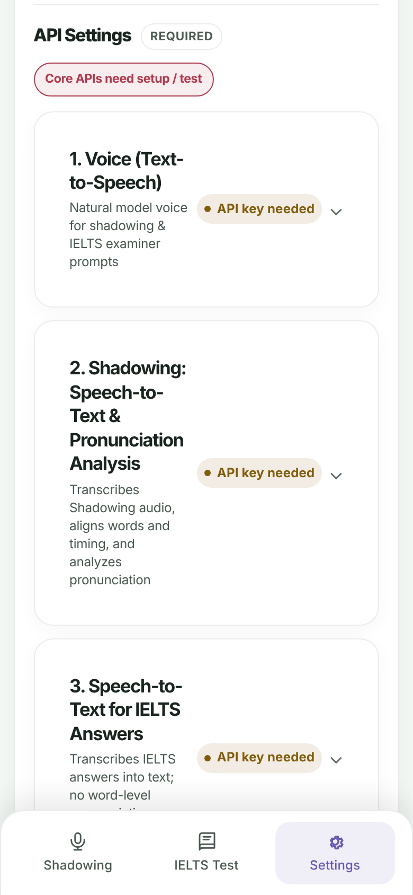 | 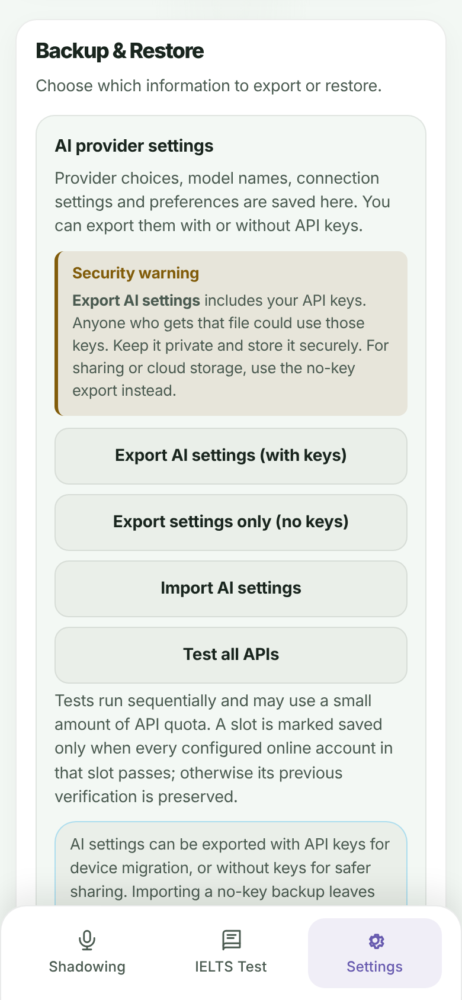 |

<details>
<summary>تم تاریک</summary>


| شدوئینگ | امتیاز شدوئینگ | پشتیبان‌گیری و Test all APIs |
|:--:|:--:|:--:|
| 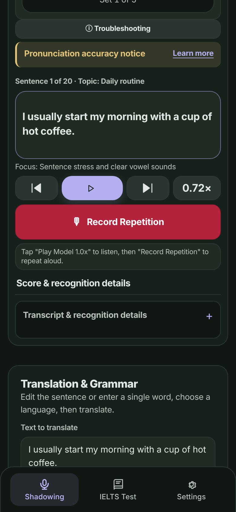 | 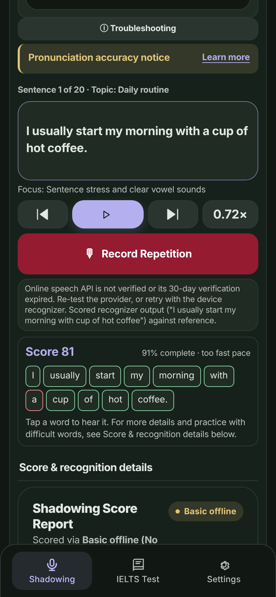 | 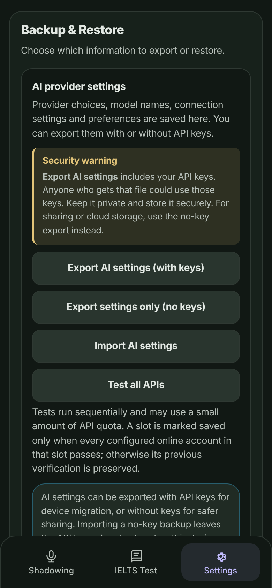 |

</details>

</div>

<div dir="rtl">

## حمایت از پروژه ☕

SpeakCoach **رایگان** است و بدون سرور و اشتراک ارائه می‌شود. اگر برایتان مفید بود و دوست داشتید از ادامهٔ توسعه‌اش حمایت کنید، می‌توانید من را یک قهوه مهمان کنید:

<div align="center">

<a href="https://www.coffeebede.com/ariyand"></a>

</div>

حمایت مالی کاملاً اختیاری است؛ ستاره‌دادن به مخزن، گزارش باگ و معرفی برنامه به دوستانتان هم خیلی کمک می‌کند. 💜

## مجوز

هنوز فایل مجوزی به این مخزن اضافه نشده است؛ تا زمان افزودن، همهٔ حقوق نزد نویسنده محفوظ است.

</div>
