<div align="center">


# SpeakCoach

**Multilingual shadowing and English IELTS Speaking practice for Android — bring your own AI, no backend, your keys stay on your phone.**

[English](README.md) · [فارسی](README.fa.md)

[](https://github.com/AriyanD/SpeakCoach/releases/latest)
[](https://github.com/AriyanD/SpeakCoach/actions/workflows/build-apk.yml)


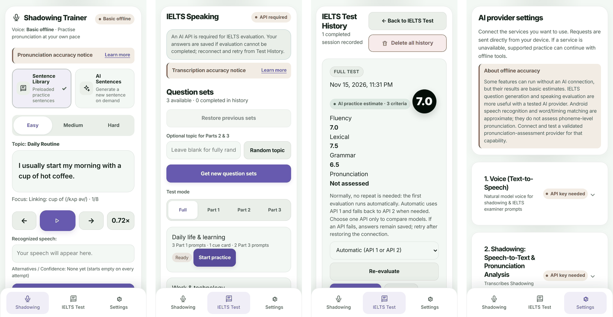

</div>

> Screenshots were captured from the app UI with **clearly fictional sample data** (sample question sets and one sample IELTS result). The Shadowing score was produced with simulated speech-recognition output and no provider connected. No real provider or account is shown.

<div align="center">

<h2><a href="https://www.coffeebede.com/ariyand">☕ Buy me a coffee</a></h2>

<sub>SpeakCoach is free, has no server and no subscription. If it helps your practice, a coffee keeps it going. 💜</sub>

</div>

## What is SpeakCoach?

SpeakCoach is a practice coach for people who want to practise speaking in multiple languages and prepare for the IELTS Speaking test in English. It has two main tools:

- **Shadowing Trainer** – listen to a sentence, repeat it, and get word-level feedback on what you said and how closely your timing followed the model.
- **IELTS Speaking** – practise Full test, Part 1, Part 2 (with a preparation timer and notes) or Part 3 using AI-generated question sets, then receive a practice-estimate evaluation.

There is **no SpeakCoach server and no subscription**. You connect your own AI providers (for example Google Gemini or Groq/Whisper) and the app talks to them directly from your device.

## Features

### Shadowing
- Built-in multilingual sentence library by **language**, **topic** and **difficulty** (Easy / Medium / Hard).
- **AI-generated sentence sets** (20 sentences) on demand, optionally on a topic you choose, with a **history** you can step back through.
- Playback with **speed control** (normal and 0.72×), word-by-word alignment and timing, and replay of your own recording where available.
- A **compact score strip** right under the Record button: overall score, colour-coded word chips (tap a word to hear it) and details below.
- Approximate scores for pronunciation, fluency, pace and completeness, with weak words highlighted for a quick retry.
- **Fast replays:** AI voice audio for the active set is saved on your phone, so sentences you already heard play again instantly, even after restarting the app. Upcoming sentences are fetched in the background in groups of four as you progress (can be switched off in Settings to save quota).

### IELTS Speaking
- Modes: **Full test, Part 1, Part 2, Part 3**.
- **AI-generated question sets** (optional topic or random topic), reusable and restorable, with an undo for the last generation.
- Part 2 **preparation countdown and notes**.
- **History and trends**, per-criterion feedback, corrections, vocabulary upgrades, and **re-evaluation** with Automatic, API 1 only or API 2 only. A failed re-evaluation shows its reason on the spot and never overwrites a score you already have.
- Interrupted sessions keep your answers so you can retry evaluation later.

### Flexible AI, with fallbacks
Six independent provider slots, each with its own configuration and **API 1 → API 2 fallback**; an offline tier is available where supported:

| Slot | What it does | Basic fallback |
|---|---|---|
| Voice / TTS | Reads model sentences and examiner prompts | Android Text-to-Speech |
| Pronunciation / Shadowing | Transcribes and aligns your shadowing attempt | Android speech recognition + approximate alignment |
| IELTS Speech-to-Text | Transcribes IELTS answers | Android speech recognition |
| IELTS Evaluator | Fluency, Lexical Resource, Grammar feedback | None – answers are saved for retry |
| Question & Sentence Generator | Creates IELTS sets and shadowing sentences | Previously generated sets stay available |
| Shadowing Translator | Translates the current Shadowing sentence and selected words | No offline translation; configure an online provider |

API 2 is an **opt-in backup account** per slot. A connection test is tied to the exact provider, endpoint, model/voice and key, and stays valid for 30 days; when an API needs a re-test, is cooling down after a rate limit, or the app falls back to the offline tier, SpeakCoach tells you why instead of failing silently. **Settings → Backup & Restore → Test all APIs** re-tests every configured account in one go and saves a slot only when all its configured online accounts pass.

Supported provider types include OpenAI-compatible endpoints, custom OpenAI-compatible gateways, Azure, ElevenLabs, Google Gemini, Whisper-style transcription (for example Groq) and Android's built-in speech services.

### Built for real phones
- **Guided first launch** in **English or فارسی** with a 7-page setup guide (where to get API keys, which slot does what, a ready-to-paste prompt for asking a chatbot for help).
- **Light / Dark / System** theme.
- **Manual backup & restore** of AI settings (with keys, treat as a password file) or test data (without keys).
- **In-app updates** from GitHub Releases, verified with SHA-256 before install.
- Redacted diagnostics page for troubleshooting without leaking keys.

### Privacy and security
- No analytics backend and no SpeakCoach-operated server; requests go straight to the providers you configure.
- API keys are stored with **Android Keystore (AES-GCM)** and are never silently downgraded to plaintext.
- Android automatic cloud backup is disabled; use the manual backup instead.
- Microphone and TTS are released when the app goes to the background.
- Saved AI voice audio is a device-local cache for up to three sentence sets, including the active set (budgeted at roughly 30 MB per set); when another set is cached, the oldest inactive set is evicted. The cache is never included in backups, and your own microphone recordings are never stored in it.

## Honest limitations

SpeakCoach is a practice tool, not an exam:

- **AI bands are practice estimates, not official IELTS scores.**
- **Pronunciation is not given an IELTS band.** Speech-recognition confidence is not a valid pronunciation measure, so the app marks it "Not assessed".
- **Shadowing scores are approximate** (word matching, alignment, timing); there is no phoneme-level assessment.
- **No built-in IELTS question bank.** Question sets need an online AI provider; sets you generated earlier stay available offline.
- **Offline recognition depends on your phone.** Android's recognizer may still need a network connection.
- Online AI features use **your** provider accounts and quota. A successful connection test does not certify a provider's accuracy.

## Install

1. Open the [**Releases**](https://github.com/AriyanD/SpeakCoach/releases/latest) page and download `SpeakCoach-vX.Y.Z.apk`.
2. Allow installation from your browser/file manager when Android asks, then open the APK.
3. Launch SpeakCoach, choose your language and follow the setup guide.

Requires Android 6.0 (API 23) or newer. Android 5.1 (API 22) and older are not supported. See [docs/DEVICE_TEST_CHECKLIST.md](docs/DEVICE_TEST_CHECKLIST.md) for the manual device test list.

## Quick start

1. **Get an API key.** Free-tier friendly options: [Google AI Studio](https://aistudio.google.com/app/apikey) (Gemini) and [Groq](https://console.groq.com/keys) (Whisper transcription).
2. In **Settings**, configure each of the **six slots separately**: choose its provider, enter its API key (and Base URL/model when required), tap **Test**, then **Save**. The six slots are Voice/TTS, Shadowing analysis, IELTS Speech-to-Text, IELTS Evaluator, Question & Sentence Generator, and **Shadowing Translator**. The translator has its own independent API configuration; set it up too if you want sentence/word translation. You can enable API 2 as a fallback inside each slot. After restoring a backup, or when a test is older than 30 days, use **Settings → Backup & Restore → Test all APIs** to re-check everything at once.
3. **Shadowing:** pick a topic and level, listen, then record yourself.
4. **IELTS:** tap *Get new question sets*, choose a mode and start practising. Review the feedback in *Test History*.

## Build from source

Requirements: Node.js 20+ and npm (JDK 21 and the Android SDK for APKs).

```bash
npm ci
npm test            # Vitest suite
npm run dev         # browser dev server (see MOBILE_PREVIEW.md)
npm run build       # type-check + production web build

npm run cap:sync    # build and sync to Android
cd android && ./gradlew assembleDebug
```

Pushing a `v*` tag runs the GitHub Actions workflow and publishes a signed `SpeakCoach-vX.Y.Z.apk` release. Signing secrets, version syncing, in-app update rules, backup semantics and dependency notes are documented in [docs/TECHNICAL_NOTES.md](docs/TECHNICAL_NOTES.md).

## Tech stack

TypeScript · vanilla DOM UI · Vite · Capacitor 6 (Android) · Vitest · GitHub Actions. Design decisions are recorded in [DECISIONS.md](DECISIONS.md).

## Documentation

- [Technical notes: release, signing, updates, backups](docs/TECHNICAL_NOTES.md)
- [Device test checklist](docs/DEVICE_TEST_CHECKLIST.md)
- [Architecture decisions](DECISIONS.md)
- [Changelog and upcoming release notes](CHANGELOG.md)
- [Mobile preview in the browser](MOBILE_PREVIEW.md)

## Screenshots

| Language | Setup guide | Shadowing |
|:--:|:--:|:--:|
| 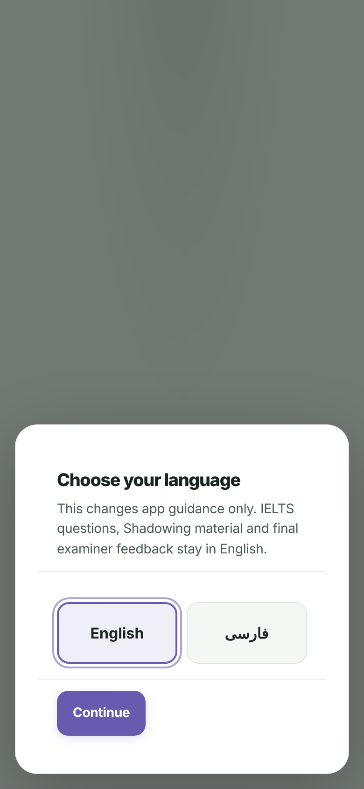 | 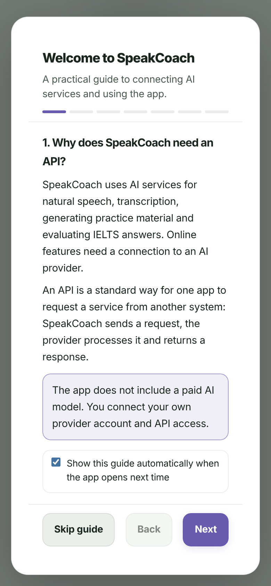 | 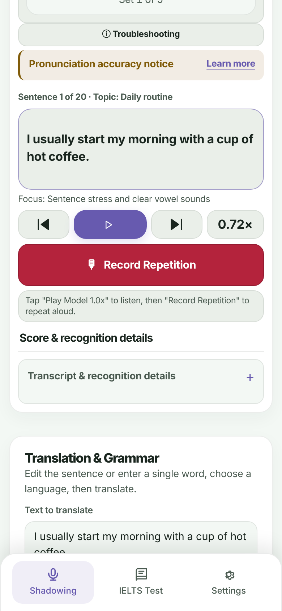 |

| Shadowing score | IELTS | Test history (sample) |
|:--:|:--:|:--:|
| 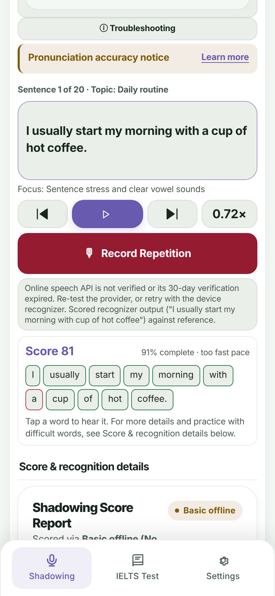 | 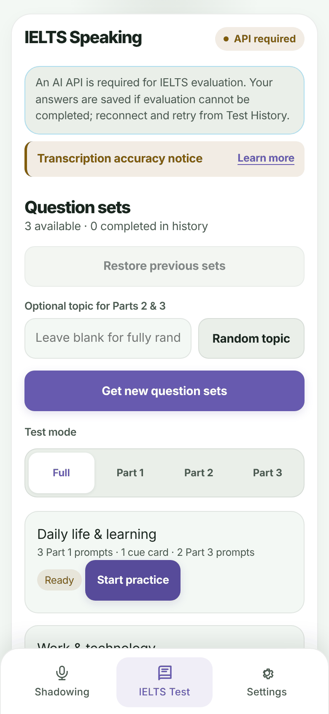 | 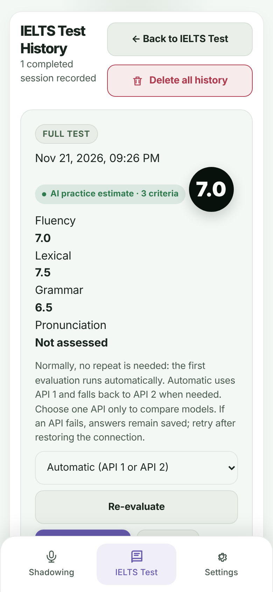 |

| Settings | Backup & Test all APIs |
|:--:|:--:|
| 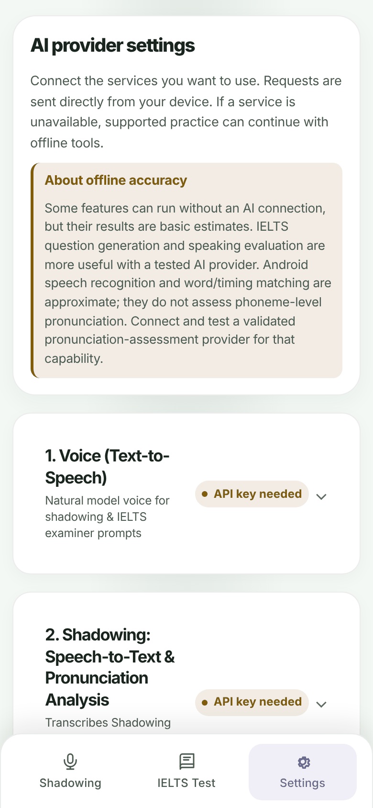 | 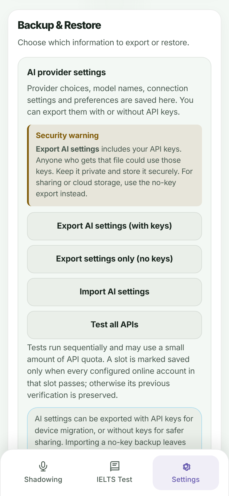 |

<details>
<summary>Dark theme</summary>

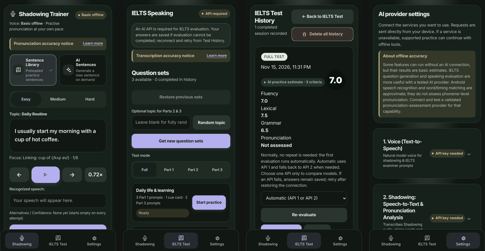

| Shadowing | Shadowing score | Backup & Test all APIs |
|:--:|:--:|:--:|
| 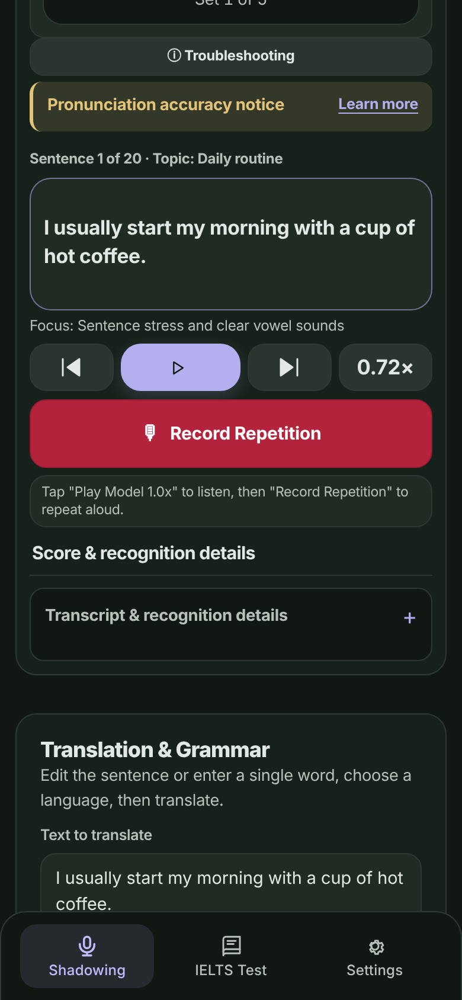 | 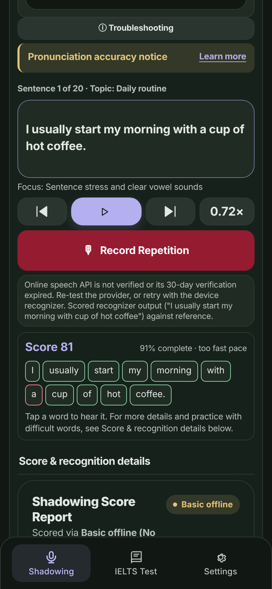 | 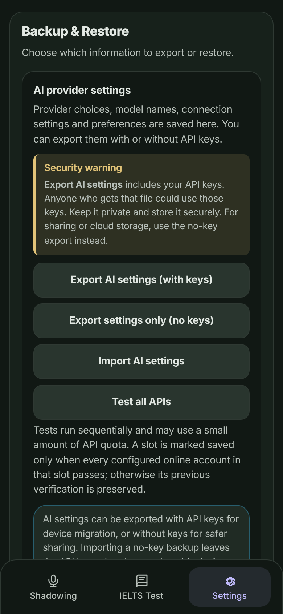 |

</details>

## Support the project ☕

SpeakCoach is free and built in spare time. If it helps your practice and you would like to support further development:

<h3 align="center"><a href="https://www.coffeebede.com/ariyand">☕ Buy me a coffee</a></h3>

Support is entirely optional. Starring the repository, reporting bugs and sharing the app with a friend help just as much. 💜

## License

No license file has been added to this repository yet. Until one is added, all rights are reserved by the author.
